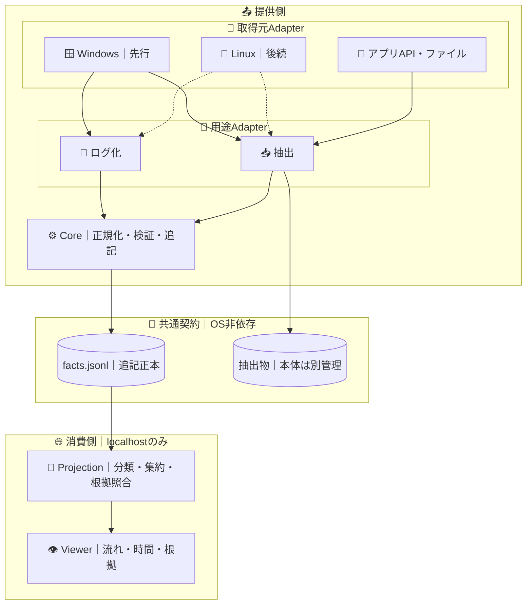

# visions

業務の**観測事実を残し、流れ・時間・根拠を可視化する**小さな基盤。Windowsを先行し、Linuxや別の取得手段にも拡張する。

## 何を見せるか

1. **流れ**：何が、どの順に起きたか。
2. **時間**：どこで時間が経過し、何が繰り返されたか。
3. **根拠**：その表示はどの記録に基づくか。不明なら不明と示す。

初期画面はlocalhostの読取専用1画面だけ。操作の順序を業務上の因果、時刻差を作業時間、記録区間を1件の業務と**断定しない**。

## 境界

CoreはWindows/LinuxのAPIを知らない。ViewerはOS、RPA、抽出の実行方法を知らない。RPAツール対応は必要になったときだけ用途Adapterに追加する。

## 最小ドメイン契約

正本は**1種類のRecord**（追記型JSONL）。各行の共通項目は `id`・`kind`・`at`（観測時刻）・`source`・`seq`・`capture_id?`・`data`。

| `kind` | `data` に必要な意味 | 表す事実 |
| --- | --- | --- |
| `capture` | `phase`（start/end）、`scope` | 記録区間の境界 |
| `observation` | `event`、`target?` | 観測した操作・状態変化 |
| `artifact` | `ref`、`type`、`digest?`、`count?` | 抽出物への参照・検証用情報 |

- `source` は取得元・Adapterを識別し、`seq` は**同一取得元内**の順序を表す。異なる取得元の厳密な順序は推定しない。
- `capture_id` は観測区間の参照であって、**Case ID（業務案件）ではない**。不明な業務単位を捏造しない。
- OS固有の識別子はAdapter内で扱う。`target` に患者名・入力文字・画面の生ラベルを保存しない。
- 個人情報、パスワード、キーストローク、画面画像は既定で記録しない。保存前に許可項目だけを通す。
- `artifact` は抽出データの中身ではない。成果物は別管理し、記録には参照・検証情報だけ残す。

## 可視化は投影で作る

`facts.jsonl + 投影規則 + 規則の版 → Step / Transition / Summary → 1画面`

- **Step**：根拠イベントに結び付いた表示単位。業務名は根拠がある場合だけ付ける。
- **Transition**：確認できる順序と回数。欠損・複数業務の混在を隠さない。
- **Summary**：経過時間・反復・戻りの候補。作業時間や改善余地とは断定しない。

投影は正本に書き戻さない。同じ入力なら同じ表示になり、各表示から元のRecordを追える。Viewerは`127.0.0.1`限定・外部送信なし・外部CDNなし。

## 並行開発の受入条件

| 提供側 | 消費側 |
| --- | --- |
| 共通Recordを検証・追記 | 合成JSONLから投影・表示 |
| Windowsのログ化・抽出Adapterを個別実装 | OSに依存せず流れ・時間・根拠を表示 |
| 将来Linux Adapterを追加 | Viewerの契約は変更しない |

最初に共有するのは**Recordの意味・合成JSONL・期待表示**だけ。両者はそれぞれ独立に合格できる。

**合格**：正本の再現性／表示から根拠への追跡／不明・欠損の非隠蔽／保存前の機微情報除外。実機捕捉率・性能・業務改善効果は未実証として別途測る。
