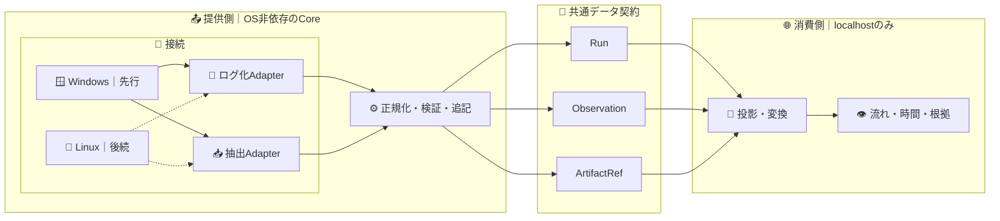

# visions

業務の**事実を記録し、流れを見せる**ための小さな基盤。Windowsから始め、Linuxや別のRPAツールを後から接続できる。

## 何を見せるか

1. **どう進んだか**：業務の順序と分岐。
2. **どこで滞ったか**：経過時間、繰り返し、戻りの候補。
3. **なぜそう見えるか**：各表示から元の観測事実へ戻れること。

最初のUIはこの3問に答える**localhostの1画面**だけ。業務の意味や完了を操作ログだけから断定しない。

## 構成

**CoreはWindows APIを知らない。ViewerはOS・RPA・抽出の実行方法を知らない。** アダプタは入力を共通契約へ変えるだけ。RPAツールも必要になった時点で接続する。

## 最小ドメインモデル

| 正本 | 最小の属性 | 意味 |
| --- | --- | --- |
| **Run** | `id`, `started_at`, `ended_at?`, `scope` | 明示された観測区間。業務1件と同一とは限らない |
| **Observation** | `id`, `at`, `source`, `kind`, `target?`, `run_id?`, `evidence?` | 観測した出来事。推測した業務名を混ぜない |
| **ArtifactRef** | `id`, `at`, `source`, `run_id?`, `type`, `count?`, `digest?` | 抽出成果物の参照と検証用メタデータ。本体は別管理 |

- 正本は追記型のJSONL。訂正・意味付けは元の観測を変更せず、別の判断として扱う。
- `source` はOS・アプリ・アダプタを識別する。OS固有の識別子は共通項目へ押し込まない。
- `run_id` や業務単位が不明なら **unknown** のまま表示する。時刻差を実作業時間と断定しない。
- パスワード、入力文字、患者情報、画面画像は既定では記録しない。保存前に許可範囲を検証する。

## 消費側だけが作る投影

`Run + Observation + ArtifactRef → Step → Transition → Summary`

- **Step**：元イベントに紐づく表示用の手順（未分類を許す）。
- **Transition**：観測できた順序・回数。業務上の因果関係とは呼ばない。
- **Summary**：経過時間・繰り返し・戻り候補と、その根拠のイベントID。

投影は正本ではない。規則を改善したら同じJSONLから再生成する。可視化は `127.0.0.1` 限定・外部送信なし・外部CDNなし。

## 並行開発と合格条件

| 提供側 | 消費側 |
| --- | --- |
| Windowsログ化Adapterと抽出Adapterを独立に追加 | 合成JSONLだけで1画面を完成 |
| 共通モデルへの変換・検証・追記 | 投影・変換・表示を実装 |
| 将来Linux Adapterへ差し替え | OSが変わっても表示コードは不変 |

**合格**：同一JSONLから同一の表示が再現される／各表示が根拠へ戻れる／不明を勝手に補わない／機微情報を保存しない。実機での捕捉率や性能は、別途測ってから主張する。
