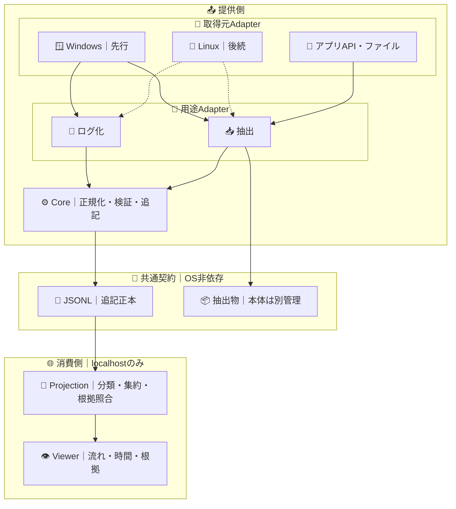

# visions

業務の**観測事実を残し、流れ・時間・根拠を可視化する**小さな基盤。Windowsを先行し、Linuxや別の取得手段にも拡張する。

## 試す

Windows用プレビューZIPを展開し、`Visions.exe`を開く。まず「デモ」→「可視化を開く」で確認する。[使い方・制約](docs/USAGE.md)／[依存とCI](docs/DEPENDENCIES.md)。

現段階は**UIAフォーカス遷移の観測と、許可された既存出力の取り込み**。全操作記録・業務データ全件抽出・本番患者データの利用は対象外。

## Process Lens

左＝誰が、右＝誰を。同じプロセスを`deps/ui`の固定版の配置・Renderer・Cameraで表示する。詳細はグラフ上のPopupだけ。独自Rendererや下部詳細パネルは持たない。[責務・依存・未確認範囲](docs/PROCESS-LENS.md)。

管理側のWorldが未提供なら未提供と表示する。以下の観測プレビューのfocusログから、ビジネスプロセスやズレを自動生成するものではない。依存の取得・ビルドが成立した配布物に描画資産を同梱し、実行時には外部取得しない。

## 何を見せるか

1. **流れ**：何が、どの順に起きたか。
2. **時間**：どこで時間が経過し、何が繰り返されたか。
3. **根拠**：その表示はどの記録に基づくか。不明なら不明と示す。

画面はlocalhostの読取専用1画面だけ。操作の順序を業務上の因果、時刻差を作業時間、記録区間を1件の業務と**断定しない**。

## 観測プレビューの境界

CoreはWindows/LinuxのAPIを知らない。ViewerはOS、RPA、抽出の実行方法を知らない。RPAツール対応は必要になったときだけ用途Adapterに追加する。WindowsのFlaUI.UIA3は5.0.0に固定し、Coreへ伝播させない。

## 最小ドメイン契約

正本は**Record v1**。共通項目は `v`・`id`・`kind`・`at`（UTC観測時刻）・`source`・`seq`・`capture_id`・`data`。初期版は明示開始した区間だけを扱い、1区間1JSONLに追記する。未知の版・項目・自由文字列は保存前に拒否する。

| `kind` | `data` に必要な意味 | 表す事実 |
| --- | --- | --- |
| `capture` | `phase`（start/end）、`scope`、`coverage`、`reason?` | 記録区間と観測範囲 |
| `observation` | `event`、`target?`、`role?`、`reason?` | フォーカス変化、または検出した欠損 |
| `artifact` | `ref`、`type`、`digest`、`bytes` | コピー本体の参照と同一性。全件性の保証ではない |

- `source` は取得元の仮名ID。`seq` は**同一取得元内**の順序で、取得元をまたぐ順序を推定しない。
- `capture_id` は**Case ID（業務案件）ではない**。未知の業務単位を作らない。
- OS固有IDは区間ごとの仮名に変える。ログに画面名・入力文字・パスワード・画像を保存しない。
- 抽出物本体は別管理し、Viewerには参照・検証情報だけを渡す。本体の個人情報を除去する機能はない。

## 可視化は投影で作る

`JSONL + 投影規則 + 規則の版 → Step / Transition / Summary → 1画面`

- **Step**：元Recordに結び付いた表示単位。初期版の業務名は未分類。
- **Transition**：確認できる順序と回数。欠損・区間境界・時計逆転をまたいで結ばない。
- **Summary**：経過と反復。作業時間・改善余地・業務完了とは断定しない。

投影は正本へ書き戻さない。同じ入力なら同じ表示になり、元Recordを追える。Viewerは`127.0.0.1`限定・読取専用・外部送信なし・外部CDNなし。

## 並行開発と合格条件

| 提供側 | 消費側 |
| --- | --- |
| 共通Recordを検証・追記 | 合成JSONLから投影・表示 |
| Windowsのログ化・抽出Adapter | OSに依存しない流れ・経過・根拠 |
| 将来Linux Adapterを追加 | 同じRecord契約を再利用 |

共有するのは**Recordの意味・合成入力・期待結果**。Core/ViewerのLinux試験と、Windowsの自己完結exe試験を1つのCIで実行する。

**合格**：再現性／根拠追跡／不明・欠損の非隠蔽／保存前検査。実業務GUIの捕捉率・非干渉・性能・改善効果は別途実測し、CI合格と取り違えない。
